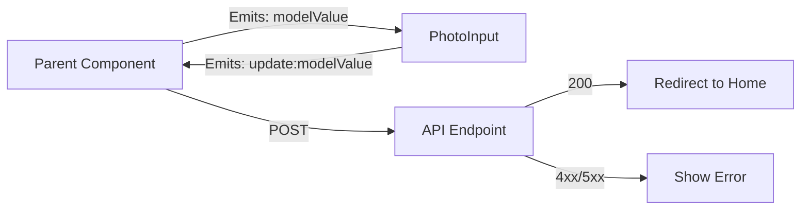

# PhotoInput Component Specification

## 1. Architecture Overview
**Recommended Implementation:**
- **PhotoInput** (Custom Input Component)
  - Handles all UI/UX for file selection, preview, and cropping
  - Emits final cropped image as `File` object
  - Maintains internal state (preview, crop, progress)
  - **Does NOT handle API calls, loading states, or business logic**
  - Self-contained component (no wrappers around existing components)

## 2. Component Specifications

### 2.1 PhotoInput Component
**Location:** `src/v3/components/Forms/PhotoInput.vue`

**Props:**
```javascript
{
  modelValue: { 
    type: [File, String, null], 
    default: null 
  }, // Current file (File object or URL)
  id: { 
    type: String, 
    required: true 
  }, // Unique identifier (for accessibility)
  placeholder: { 
    type: String, 
    default: null 
  }, // Input placeholder text
  disabled: { 
    type: Boolean, 
    default: false 
  }, // Disable interaction
  invalid: { 
    type: Boolean, 
    default: false 
  }, // Validation error state
  accept: { 
    type: String, 
    default: 'image/png,image/webp,image/jpeg,image/jpg' 
  }, // File type filter
  aspectRatio: { 
    type: Number, 
    default: 100 / 125 
  }, // Cropping aspect ratio (100:125 portrait)
  canvasSize: { 
    type: Object, 
    default: () => ({ width: 512, height: 640 }) 
  }, // Cropping canvas dimensions
  previewSize: { 
    type: Object, 
    default: () => ({ width: 250, height: 300 }) 
  }, // Preview dimensions
  attrs: { 
    type: Object, 
    default: () => ({}) 
  } // Additional attributes (maxSize, description)
}
```

**Emits:**
```javascript
{
  'update:modelValue': File, // Final cropped File object
  change: File,              // Mirrors update:modelValue for MasterForm validation hooks
  input: File,               // Legacy compatibility event (same payload)
  error: { // Error events
    type: String, // 'mime-type', 'max-size', 'blob-failed'
    allowed: String, // Allowed MIME types
    fileType: String, // Detected file type
    maxSize: Number, // Max size in bytes
    size: Number // Actual file size
  }
}
```

**Key Features:**
- Drag-and-drop interface with visual feedback
- Image preview with cropping interface (100:125 aspect ratio)
- Cancel option to reset state
- Edit option that re-opens the current preview (even if it originated from a backend-provided URL) inside the cropper
- Replace option to open the file chooser again and keep editing workflow
- Remove option that clears the current selection so the parent receives `null`
- Cropper surface stretches to the available width while preserving aspect ratio, improving desktop + mobile UX
- Cropped output is always exported as WebP (`image/webp`) with a `.webp` filename
- Emits `change`/`input` whenever Apply or Replace is used so MasterForm re-validates immediately
- Mobile-responsive design
- Accessibility-compliant (ARIA labels, keyboard navigation)
- Optional max file size via `attrs.maxSize` (validated on the cropped output file)

**User-facing text (add to `ar.json` / `arabic-user-profiles.json` with the literal English sentence as the key):**
  - `Drop files here or click to upload`
  - `PNG, JPG, or WebP up to 5MB`
  - `Cancel`
  - `Apply`
  - `Edit photo`
  - `Replace photo`
  - `Remove photo`
  - `Upload photo`
  - `Upload personal photo`
  - Guideline bullet sentences

## 3. Technical Requirements

### 3.1 Implementation Rules
- **Must use:**
  - `vue-advanced-cropper` plugin for cropping
  - Browser's `File` API
  - Tailwind CSS for styling

- **Must not use:**
  - External validation libraries
  - Axios
  - Pinia/Vuex
  - Base-card component
  - `useLoading`, `useApplication`, `useApplicationFiles`, `fetch()`

### 3.2 Validation Requirements
- **File type:** Browser-level filtering via `accept` attribute
- **File size:** Optional via `attrs.maxSize` and validated on the **cropped output file** (not the original selection)
- **Required fields:** None (component handles empty state)

### 3.3 Integration with MasterForm
**Schema Configuration:**
```javascript
{
  profilePhoto: {
    type: 'PhotoInput',
    label: 'Profile Photo',
    aspectRatio: 100 / 125,
    accept: 'image/png,image/jpeg',
    attrs: {
      maxSize: 5 * 1024 * 1024,
      description: 'Max 5MB, JPG/PNG'
    }
  }
}
```

**Usage Notes:**
- The `type: 'PhotoInput'` tells MasterForm to render the PhotoInput component
- For MasterForm schema guidance, see [MasterForm Component Guide](../guides/masterform-guide.md)
- All standard MasterForm props are supported (label, placeholder, etc.)
- `attrs` supports all standard file upload attributes (maxSize, description)
- Component automatically handles file validation and cropping
- Parent component handles all API calls and loading states

## 4. Integration with Project Architecture

### 4.1 Component Hierarchy
```
Parent Component
└── PhotoInput (Input Component)
    ├── Drag-and-drop UI
    ├── Cropping interface
    └── Progress tracking
```

### 4.2 Data Flow


## 5. Critical Implementation Notes

1. **File Handling:**
   - PhotoInput uses `vue-advanced-cropper` for cropping
   - Component workflow has three states: empty (drag-and-drop prompt), editing (cropper surface with `Cancel`/`Apply`), and preview (static thumbnail with `Edit photo`/`Replace photo`/`Remove photo`)
   - `Edit photo` streams the currently displayed preview (including URLs returned from the backend on edit screens) back into the cropper so users can re-crop existing assets without first downloading them
- Replace button re-opens the file chooser while keeping any existing preview available until a new file is chosen
- Remove button emits `null` so the parent can drop the file entirely
- `change`/`input` are emitted together with `update:modelValue` so the form receiving the component can re-run validation immediately (critical after cropping)
- Parent component handles all API submission with `fetch()` or existing HTTP client

2. **Customization:**
  - All UI dimensions (aspectRatio, canvasSize, previewSize) are configurable via props
  - File size limits are optional via `attrs.maxSize` in schema

3. **Validation:**
  - Frontend: Browser-level `accept` attribute only
  - Output file: Optional max size (`attrs.maxSize`) is enforced on the cropped output file generated from the cropper canvas.
  - Backend: Must accept `image/webp` (the cropped output) and validate size (e.g., max 5MB).

4. **Accessibility:**
  - All interactive elements have ARIA labels
   - Keyboard navigable
   - Color contrast meets WCAG standards
   - `id` prop required for accessibility
