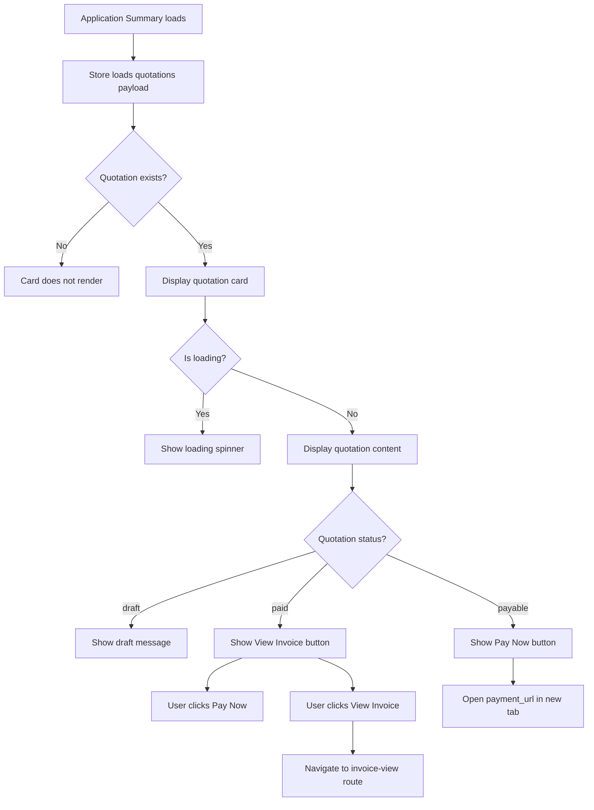

# Application Fees Card - Requirements and Specifications

**Component:** `ApplicationFeesCard.vue`
**Location:** `src/v3/components/applications/cards/`
**Version:** 1.0
**Last Updated:** 2026-01-28

---

## Overview

The Application Fees Card component displays application fee information including quotation/invoice details, line items, VAT, and payment actions. It is a universal component used across all application types (Professional Diver, Diving Center, Sport Fishing, Jetski, etc.) to show fee breakdown and payment status.

**Key Design Principle:**
- Universal component for all application types requiring fee display
- Not limited to Professional Diver applications only
- Also used for Diving Center applications
- Displays quotation items with VAT breakdown
- Provides Pay/View Invoice actions based on payment status

---

## Business Requirements

### Primary Goal
Display application fee information with clear itemization, VAT breakdown, and appropriate payment actions (Pay Now or View Invoice) for all application types.

### Key Business Rules

1. **Universal Application Support**
   - Component works for ALL application types that have quotations
   - Not limited to Professional Diver applications
   - Used for Diving Center, Sport Fishing, Jetski, etc.
   - Reads from `store.payload.quotations` array

2. **Quotation Display**
   - Display quotation/invoice number
   - Show quotation status (uppercase)
   - Display client name
   - Show line items with: Description, Qty, Unit price, VAT, Line total

3. **VAT Display**
   - Show VAT for each line item
   - Display VAT rate percentage
   - Show VAT subtotal in totals section
   - VAT is calculated as: `vat_minor ?? (total_minor - subtotal_minor)`

4. **Totals Breakdown**
   - Subtotal: Sum of all line item totals
   - VAT: Calculated VAT amount at specified rate
   - Total due: Subtotal + VAT (net_amount)

5. **Payment Actions**
   - **Pay Now** button: Shown when quotation is payable
     - Statuses: 'confirmed', 'pending'
     - Must have `payment_url` available
     - Must NOT be paid (no `invoice_id` or `paid_at`)
   - **View Invoice** button: Shown when quotation is paid
     - Status: 'paid'
     - Has `invoice_id` or `paid_at`
     - Links to `invoice-view` route

6. **Draft Status**
   - Display informational message when quotation is in 'draft' status
   - Message: "Your application is under review and has not been approved yet"
   - No payment actions shown for draft status

7. **Currency Formatting**
   - All monetary values formatted using `Intl.NumberFormat`
   - Currency code from quotation (e.g., 'SAR')
   - Maximum 2 decimal places
   - Minor amounts (stored as cents) converted to display format

---

## Functional Requirements

### FR-1: Quotation Display
**Priority:** High
**Description:** Display quotation header with number, status, and client information.

**Acceptance Criteria:**
- Quotation ID is displayed
- Quotation status is displayed in uppercase
- Client name is displayed
- Compact layout with badges and separators

### FR-2: Items Table
**Priority:** High
**Description:** Display line items in a table with proper columns.

**Acceptance Criteria:**
- Table columns: Description, Qty, Unit price, VAT, Line total
- Description is translated using `$t()`
- Qty is right-aligned with whitespace-nowrap
- Unit price is formatted as currency
- VAT is calculated and formatted as currency
- Line total is formatted as currency
- Table has overflow-x-auto for responsive scrolling

### FR-3: Totals Section
**Priority:** High
**Description:** Display subtotal, VAT, and total due amounts.

**Acceptance Criteria:**
- Subtotal is displayed with currency formatting
- VAT is displayed with percentage rate (e.g., "VAT (15%)")
- VAT amount is displayed with currency formatting
- Total due is displayed with bold text and currency formatting
- Right-aligned layout with proper spacing

### FR-4: Payment Actions
**Priority:** High
**Description:** Provide appropriate action buttons based on quotation status.

**Acceptance Criteria:**
- **Pay Now** button shown when:
  - Status is 'confirmed' or 'pending'
  - `payment_url` is available
  - Not paid (no `invoice_id` or `paid_at`)
  - Opens `payment_url` in new tab
  - Uses `pill-link` class for proper styling
- **View Invoice** button shown when:
  - Status is 'paid'
  - Has `invoice_id` or `paid_at`
  - Navigates to `invoice-view` route with `id` and `locale` params
  - Uses emerald color scheme
- No buttons shown for 'draft' status

### FR-5: Draft Status Message
**Priority:** Medium
**Description:** Display informational message for draft quotations.

**Acceptance Criteria:**
- Message displayed when status is 'draft'
- Message text: "Your application is under review and has not been approved yet"
- No payment buttons shown
- Message uses muted text color

### FR-6: Currency Formatting
**Priority:** High
**Description:** Format all monetary values consistently.

**Acceptance Criteria:**
- `formatMoney()` function uses `Intl.NumberFormat`
- Currency code from quotation data
- Maximum 2 decimal places
- `formatMinor()` function converts minor amounts to display format
- Consistent formatting across all displays

### FR-7: Data Loading
**Priority:** High
**Description:** Handle loading state while fetching quotation data.

**Acceptance Criteria:**
- Loading spinner displayed while `isLoadingKey('quotations')` is true
- Quotation content hidden during loading
- Card wrapper maintains consistent styling

### FR-8: Empty State
**Priority:** Medium
**Description:** Do not display card if no quotation exists.

**Acceptance Criteria:**
- Entire card is hidden if `quotation` is null
- No empty state message displayed
- Component simply doesn't render

---

## Non-Functional Requirements

### NFR-1: Performance
- Card renders in < 1 second after data loads
- Currency formatting is efficient (no re-renders)
- Table scrolling is smooth

### NFR-2: Usability
- Clear visual hierarchy with proper spacing
- Responsive table with horizontal scroll on mobile
- Accessible to screen readers
- Keyboard navigation works correctly
- Intuitive action buttons with icons

### NFR-3: Security
- Payment URL opens in new tab (security best practice)
- `rel="noopener"` attribute on payment link
- No sensitive data in client-side logs

### NFR-4: Internationalization
- Full Arabic translation support
- RTL layout for Arabic
- English numerals in both languages
- Labels, status, and messages use English keys with Arabic translations in `src/locales/ar.json`

### NFR-5: Browser Compatibility
- Chrome (latest 2 versions)
- Firefox (latest 2 versions)
- Safari (latest 2 versions)
- Edge (latest 2 versions)

---

## Technical Specifications

### Component Architecture

**Pattern:** Self-contained display card that reads from centralized store.

**Key Technologies:**
- Vue 3 Composition API (`<script setup>`)
- PrimeVue components (none used)
- Tailwind CSS with `tw-` prefix
- Vue Router for navigation

### Dependencies

**Composables:**
- `useI18n` - Internationalization
- `useApplicationStore` - Access to application data
- `useLoading` - Loading state management

**Components:**
- `RouterLink` - For View Invoice navigation

### Data Source

**Store Access:**
- `store.payload.quotations.value?.[0]` - First quotation in array
- `isLoadingKey('quotations')` - Loading state from store

### API Endpoints

No direct API calls - data is loaded via store's unified payload system.

### State Management

**Computed Properties:**
- `quotation` - First quotation from payload array
- `isPaid` - Boolean: `quotation?.invoice_id || quotation?.paid_at`
- `canPayStatus` - Boolean: Status is 'confirmed' or 'pending' AND has payment_url AND not paid
- `isDraft` - Boolean: Status is 'draft'
- `showPayButton` - Alias for `canPayStatus`

**Helper Functions:**
- `num(x)` - Safe number conversion (returns 0 for non-finite)
- `formatMoney(val, currency)` - Format as currency using Intl.NumberFormat
- `formatMinor(minor, currency)` - Format minor amounts as currency

### Validation Rules

None - This is a display-only component with no form validation.

---

## User Flow



---

## Edge Cases

### EC-1: No Quotation
**Scenario:** Application has no quotation data
**Expected:** Card does not render
**Action:** Empty state - nothing displayed

### EC-2: Draft Quotation
**Scenario:** Quotation is in 'draft' status
**Expected:** Informational message displayed, no payment actions
**Action:** Show "Your application is under review and has not been approved yet"

### EC-3: Paid Quotation
**Scenario:** Quotation has been paid
**Expected:** View Invoice button displayed
**Action:** Navigate to `invoice-view` route with quotation ID

### EC-4: Payable Quotation Without Payment URL
**Scenario:** Quotation is payable but no payment_url available
**Expected:** Pay button not shown
**Action:** No payment action available

### EC-5: Invalid Currency Code
**Scenario:** Quotation has invalid or missing currency code
**Expected:** Default to 'SAR'
**Action:** `formatMoney()` uses default 'SAR' if currency is invalid

### EC-6: Missing VAT Minor
**Scenario:** Line item has no `vat_minor` field
**Expected:** VAT calculated from total_minor - subtotal_minor
**Action:** Display calculated VAT amount

### EC-7: Multiple Quotations
**Scenario:** Payload contains multiple quotations
**Expected:** Display first quotation only
**Action:** Use `quotations[0]` to get first item

---

## Testing Requirements

### Unit Tests
- [ ] `formatMoney()` formats correctly with various currencies
- [ ] `formatMinor()` converts minor amounts correctly
- [ ] `num()` handles non-finite values safely
- [ ] `isPaid` computed returns true when invoice_id exists
- [ ] `isPaid` computed returns true when paid_at exists
- [ ] `canPayStatus` computed returns true for 'confirmed' status with payment_url
- [ ] `canPayStatus` computed returns false for paid quotations
- [ ] `isDraft` computed returns true for 'draft' status
- [ ] VAT calculation fallback works when vat_minor is missing

### Integration Tests
- [ ] Card renders when quotation exists in payload
- [ ] Card does not render when quotation is null
- [ ] Loading state displays correctly
- [ ] Draft message displays for 'draft' status
- [ ] Pay Now button opens correct payment_url
- [ ] View Invoice button navigates to correct route
- [ ] Currency formatting displays correctly for different locales
- [ ] Table is responsive on mobile devices
- [ ] `pill-link` class prevents CSS override issues

### E2E Tests
- [ ] Complete user flow from card load to payment
- [ ] Pay Now button opens payment in new tab
- [ ] View Invoice button navigates to invoice page
- [ ] Draft status message displays correctly
- [ ] Totals section displays correctly
- [ ] VAT column displays calculated values

---

## Accessibility Requirements

- [ ] All table headers have proper scope
- [ ] Table cells have proper semantic structure
- [ ] Buttons have accessible labels (aria-hidden icons)
- [ ] Loading state has proper ARIA attributes
- [ ] Keyboard navigation works correctly
- [ ] Screen reader announces status changes
- [ ] Color contrast meets WCAG AA standards
- [ ] Links have proper rel attributes

---

## Translation Requirements

### English (Default)
English strings are used directly as i18n keys (no extra mapping layer).

### Arabic
All user-facing text must be translated in `src/locales/ar.json`, including:
- Application Fees
- Description
- Qty
- Unit price
- VAT
- Line total
- Subtotal
- Total due
- View invoice
- Pay now
- Your application is under review and has not been approved yet

Minimum required keys:

```json
{
  "Application Fees": "رسوم الطلب",
  "Description": "الوصف",
  "Qty": "الكمية",
  "Unit price": "سعر الوحدة",
  "VAT": "ضريبة القيمة المضافة",
  "Line total": "المجموع",
  "Subtotal": "المجموع الفرعي",
  "Total due": "المجموع المستحق",
  "View invoice": "عرض الفاتورة",
  "Pay now": "ادفع الآن",
  "Your application is under review and has not been approved yet": "طلبك قيد المراجعة ولم تتم الموافقة عليه بعد"
}
```

---

## Future Enhancements

1. **Print/Download Quotation**
   - Add button to download quotation as PDF
   - Add button to print quotation

2. **Payment History**
   - Show previous payment attempts
   - Display transaction history

3. **Multiple Quotations Support**
   - Display tabs for multiple quotations
   - Allow switching between quotations

4. **Currency Converter**
   - Display amounts in multiple currencies
   - Allow user to select preferred currency

5. **Payment Method Selection**
   - Allow choosing payment method (credit card, Mada, Apple Pay)
   - Save preferred payment method

---

## References

- [ApplicationFeesCard.vue](../../../src/v3/components/applications/cards/ApplicationFeesCard.vue) - Current implementation
- [QuotationItemsView.vue](../../../src/v3/pages/quotations/QuotationItemsView.vue) - Reference for layout and functionality
- [ApplicationSummary Page](../pages/ApplicationSummary.md) - Parent page that renders this card
- [Global Development Guide](../guides/global-guide.md) - Coding standards and patterns
- [Translation Guide](../guides/translation-guide.md) - Translation strategy
- [MasterForm Guide](../guides/masterform-guide.md) - MasterForm usage
- [Refactoring Guide](../guides/refactoring-guide.md) - Refactoring best practices
- [Requirements - Professional Diver New License](./professional-diver-new-license.md) - Related application requirements
- [Requirements - Diving Center New Membership](./diving-center-new-membership.md) - Diving Center application requirements
- [Requirements - Sport Fishing Competition Team Registration](./sport-fishing-competition-team-registration.md) - Sport Fishing application requirements

---

**Last Updated:** January 28, 2026
**Version:** 1.0
**Status:** Active
