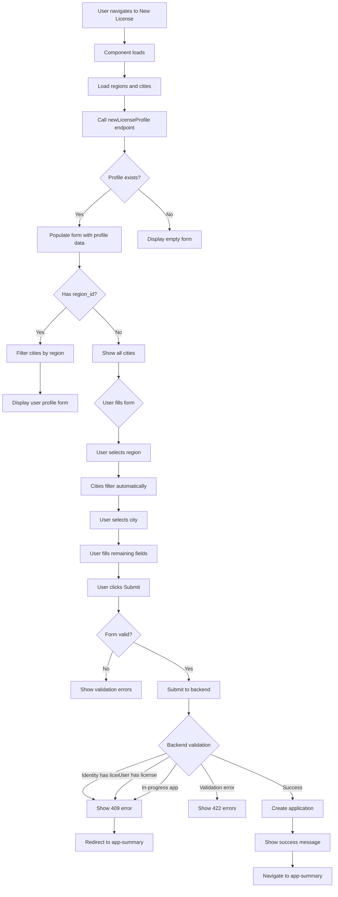
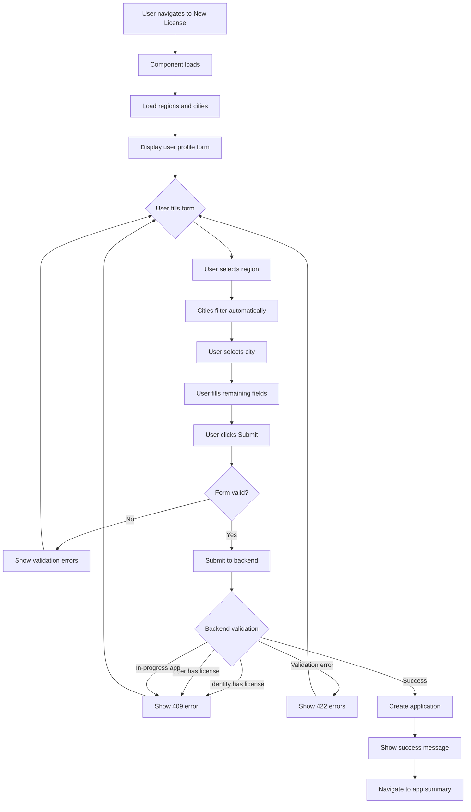

# Professional Diver New License - Requirements and Specifications

**Component:** `NewLicense.vue`
**Location:** `src/v3/pages/applications/professional-divers/`
**Version:** 2.0
**Last Updated:** 2026-01-26

---

## Overview

The Professional Diver New License component is the entry point for users applying for a new professional diver license. It collects user profile information (including identity number) and submits to the backend, which validates for existing licenses to prevent duplicates across multiple user accounts.

**Enhancement (v2.0):** Integrated `newLicenseProfile` backend endpoint for automatic profile prefill, restoring the user experience from legacy implementation.

---

## Business Requirements

### Primary Goal
Enable users to apply for a professional diver license while preventing duplicate licenses through identity number validation.

### Key Business Rules

1. **Identity Number Uniqueness**
   - Each identity number can only have ONE professional diver license
   - Users with multiple accounts cannot create duplicate licenses
   - Backend validates identity number before creating application

2. **User Profile Required**
    - All personal information must be collected before license creation
    - Identity number is mandatory for validation
    - Profile data is saved with the application
    - **NEW:** Active user profiles are automatically loaded and pre-filled from `newLicenseProfile` endpoint

3. **International Membership Requirement**
   - At least one international membership record is required before submitting the application
   - Membership verification happens after application approval; memberships remain Unverified until admin review
   - Unverified memberships are allowed at submission, but each must include evidence (e.g., membership card copy)
   - Newly added memberships default to Unverified; no requirement message is shown solely due to Unverified status

4. **License Information (Rank + Card Design) Requirement**
   - License information must be provided as part of the Professional Diver application process
   - This step is edited in `UpdateLicenseInformations.vue` and reviewed on the summary via `PDLicenseInformationCard.vue`
   - Data is loaded via `applications/byId` payload key `pd_license` (new unified payload approach)
   - Saving uses `professional-divers-applications/set-services/{appId}`

5. **Application Creation**
   - Application is created only after successful validation
   - User is redirected to application summary after creation
   - Application ID is returned for subsequent steps

---

## Functional Requirements

### FR-1: User Profile Form Display
**Priority:** High
**Description:** Display a comprehensive user profile form with all required fields, with automatic profile prefill.

**Acceptance Criteria:**
- Form displays all required profile fields
- Fields are properly validated
- Form follows v3 design patterns
- RTL support for Arabic language
- Responsive layout for mobile devices
- **NEW:** Active profile data is pre-filled if available
- **NEW:** Empty form displayed if no active profile exists

**Fields Required:**
- Name (Arabic) - 3 words, Arabic characters only
- Name (English) - 3 words, Latin characters only
- Identity Number - 10 digits, starts with 1 or 2
- Birthdate - Valid date (`YYYY-MM-DD`)
- Gender - Male/Female selection
- Nationality - Free text
- Mobile - KSA format validation
- Email - Valid email format
- Region - Dropdown selection
- City - Filtered by selected region

### FR-2: International Membership Requirement
**Priority:** High  
**Description:** Require at least one international membership before submission.

**Acceptance Criteria:**
- Application summary shows the memberships step as required until at least one membership record is added
- Newly added memberships default to Unverified
- Evidence (membership copy) is required for each submitted membership
- No requirement message is shown when memberships exist, even if they are Unverified

### FR-3: License Information Requirement
**Priority:** High  
**Description:** Require license information (rank + card design) before submitting the application.

**Acceptance Criteria:**
- The application summary shows a License Informations section/card
- User can edit the step via route `pd-license-info-update`
- Saving posts `rank` and `card_design_id` to `professional-divers-applications/set-services/{appId}`
- After saving, the user returns to `app-summary`

### FR-4: Dynamic Region/City Selection
**Priority:** High  
**Description:** Implement cascading dropdown for region and city selection

**Acceptance Criteria:**
- Regions load from `addresses/common` endpoint
- Cities load from `addresses/common` endpoint
- Selecting region filters cities to show only cities in that region
- Changing region clears previously selected city if invalid
- City dropdown is disabled until region is selected
- City dropdown is enabled when region has cities

### FR-5: Form Validation
**Priority:** High  
**Description:** Validate all form fields before submission

**Acceptance Criteria:**
- All required fields show asterisk indicator
- Field-level validation on blur
- Real-time validation for fields with errors
- Error summary displayed at top of form
- Clear, user-friendly error messages
- Arabic translations for all error messages
- Placeholders and validation messages use i18n keys (English strings) with Arabic translations

### FR-6: Backend Validation
**Priority:** Critical  
**Description:** Submit form data to backend for validation and application creation

**Acceptance Criteria:**
- Submit to `VITE_PROFESSIONAL_DIVERS_NEW_LICENSE` endpoint
- Backend checks for existing license by identity number
- Backend checks if user already has a license
- Backend checks for in-progress applications
- Handle 409 conflict errors appropriately
- Handle 422 validation errors appropriately
- Display backend error messages to user
- Backend error messages should be stable i18n keys if they must be translated

### FR-7: Application Creation
**Priority:** High  
**Description:** Create application and navigate to summary on success

**Acceptance Criteria:**
- Application is created with user profile data
- Application ID is returned from backend
- User is redirected to application summary page
- Success notification is displayed
- Loading state is shown during submission

### FR-8: Error Handling
**Priority:** High  
**Description:** Handle all error scenarios gracefully

**Acceptance Criteria:**
- 409 errors show appropriate message
- **NEW:** 409 from `newLicenseProfile` endpoint redirects appropriately:
  - If response contains `application.id`: redirect to `app-summary` page
  - Otherwise: redirect to `professional-diver-license` page
- 422 errors show field-level validation errors
- Network errors show generic error message
- Errors are logged for debugging
- User can retry after fixing errors

---

## Non-Functional Requirements

### NFR-1: Performance
- Form loads in < 2 seconds
- Region/city data loads in < 1 second
- Form submission completes in < 3 seconds
- No UI blocking during data loading

### NFR-2: Usability
- Form follows v3 design system
- Clear visual hierarchy
- Accessible to screen readers
- Keyboard navigation support
- Mobile-friendly layout

### NFR-3: Security
- All data transmitted over HTTPS
- Identity number is validated server-side
- No sensitive data in client-side logs
- CSRF protection enabled

### NFR-4: Internationalization
- Full Arabic translation support
- RTL layout for Arabic
- English numerals in both languages
- Date format: use MasterForm DatePicker defaults (model value is `YYYY-MM-DD`)
- Labels, placeholders, validation messages, and toast notifications use English keys with Arabic translations in `src/locales/ar.json`

### NFR-5: Browser Compatibility
- Chrome (latest 2 versions)
- Firefox (latest 2 versions)
- Safari (latest 2 versions)
- Edge (latest 2 versions)

---

## Technical Specifications

### Component Architecture

**Pattern:** Follows `UserProfileUpsert.vue` pattern

**Key Technologies:**
- Vue 3 Composition API (`<script setup>`)
- MasterForm component for schema-driven forms
- Valibot for validation
- PrimeVue components
- Tailwind CSS with `tw-` prefix

### Dependencies

**Composables:**
- `useNotification` - User feedback (translates summary/detail when key exists)
- `useErrorHandler` - Error logging
- `usePageHeading` - Page title
- `useLoading` - Loading states

**Schema:**
- `makeUserProfileSchema` - Form schema builder
- `serializeProfile` - Data serialization
- City filtering handled via `formOptions` and `@field-change`

**API:**
- `apiGet` - GET requests
- `apiPost` - POST requests

### API Endpoints

#### 1. Load Address Data
**Endpoint:** `GET /addresses/common`  
**Purpose:** Load regions and cities for dropdowns

**Response:**
```json
{
  "regions": [
    { "id": 1, "name": "Riyadh" }
  ],
  "cities": [
    { "id": 1, "name": "Riyadh City", "region_id": 1 }
  ]
}
```

#### 2. Load User Profile (NEW)
**Endpoint:** `GET /professional-divers-applications/new-license-profile`
**Purpose:** Fetch active user profile for prefill and validation

**Response:**
```json
{
  "profile": {
    "name_ar": "محمد أحمد علي",
    "name_en": "Mohammed Ahmed Ali",
    "identity_number": "1234567890",
    "nationality": "Saudi",
    "gender": "Male",
    "birthdate": "1990-01-15",
    "mobile": "966512345678",
    "email": "user@example.com",
    "region_id": 1,
    "city_id": 10,
    "address": "Street address"
  }
}
```

**Error Response (409 - Conflict):**
```json
{
  "message": "You already have a license"
}
```

```json
{
  "message": "You already have an in-progress application",
  "application": {
    "id": 789
  }
}
```

#### 3. Create License Application
**Endpoint:** `POST /professional-divers-applications/new-license`  
**Purpose:** Create application and validate identity number

**Request:**
```json
{
  "name_ar": "محمد أحمد علي",
  "name_en": "Mohammed Ahmed Ali",
  "identity_number": "1234567890",
  "birthdate": "1990-01-15",
  "gender": "Male",
  "nationality": "Saudi",
  "mobile": "0501234567",
  "email": "user@example.com",
  "region_id": 1,
  "city_id": 1,
  "address": "Street, District"
}
```

**Success Response (201):**
```json
{
  "application": {
    "id": 123,
    "user_id": 456,
    "stage": "draft"
  },
  "applicantProfile": {
    "id": 789,
    "name_ar": "محمد أحمد علي",
    "name_en": "Mohammed Ahmed Ali"
  }
}
```

**Error Response (409 - Conflict):**
```json
{
  "message": "A license has been issued under the same Identity Number"
}
```

**Error Response (422 - Validation):**
```json
{
  "errors": {
    "identity_number": ["Identity number must be 10 digits"],
    "email": ["Please enter a valid email address"]
  }
}
```

### State Management

**Loading States:**
- `profile-initializing` - Initial data loading (regions, cities, profile)
- `profile-saving` - Form submission

**Form State:**
- `formIsValid` - Form validation status
- `canSubmit` - Submit button enabled/disabled

**Data State:**
- `schema` - Form schema with validation
- `regions` - Available regions
- `cities` - Available cities
- `initialValues` - Pre-filled form data from profile

### Validation Rules

| Field | Type | Required | Validation |
|-------|------|----------|------------|
| name_ar | text | Yes | 3 words, Arabic characters |
| name_en | text | Yes | 3 words, Latin characters |
| identity_number | text | Yes | 10 digits, starts with 1 or 2 |
| birthdate | DatePicker | Yes | `YYYY-MM-DD` string, valid date |
| gender | select | Yes | Male/Female |
| nationality | text | Yes | Free text |
| mobile | text | Yes | KSA format |
| email | email | Yes | Valid email |
| region_id | select | Yes | Valid region ID |
| city_id | select | Yes | Valid city ID |
| address | text | No | Max 255 characters |

---

## User Flow





---

## Edge Cases

### EC-1: User Already Has License
**Scenario:** User navigates to new license page but already has a license
**Expected:** 409 error from `newLicenseProfile` endpoint
**Action:** Display error message, redirect to `professional-diver-license` page

### EC-2: Multiple Accounts, Same Identity
**Scenario:** User has multiple accounts, tries to create license on second account
**Expected:** 409 error, backend detects existing license by identity number
**Action:** Display error message, redirect to `professional-diver-license` page

### EC-3: In-Progress Application
**Scenario:** User already has an in-progress license application
**Expected:** 409 error from `newLicenseProfile` endpoint with `application.id` in response
**Action:** Display error message, redirect to `app-summary` page with application ID

### EC-4: Network Failure
**Scenario:** Network error during form submission  
**Expected:** Generic error message  
**Action:** Display error, allow user to retry

### EC-5: Region Has No Cities
**Scenario:** User selects region with no cities  
**Expected:** City dropdown remains disabled  
**Action:** Show message "No cities available for this region"

### EC-6: Invalid Identity Number Format
**Scenario:** User enters identity number not matching pattern  
**Expected:** Client-side validation error  
**Action:** Show error "Identity number must be 10 digits starting with 1 or 2"

### EC-7: Unverified Memberships
**Scenario:** User has added memberships with Unverified status  
**Expected:** No requirement message is shown  
**Action:** Allow submission once at least one membership record exists, provided evidence is uploaded

---

## Testing Requirements

### Unit Tests
- [ ] Schema initialization with empty regions/cities
- [ ] Schema initialization with populated regions/cities
- [ ] City filtering when region changes
- [ ] City value cleared when region changes
- [ ] Form validation for all fields
- [ ] Serialization of form data
- [ ] **NEW:** Profile prefill logic
- [ ] **NEW:** 409 conflict handling from newLicenseProfile endpoint
- [ ] **NEW:** Membership requirement satisfied by any membership record, regardless of Unverified status
- [ ] **NEW:** Evidence (membership copy) is required for submitted memberships

### Integration Tests
- [ ] Load regions and cities from API
- [ ] **NEW:** Load profile from newLicenseProfile endpoint
- [ ] Submit form with valid data
- [ ] Handle 409 conflict errors (license exists)
- [ ] **NEW:** Handle 409 conflict errors (in-progress application)
- [ ] Handle 422 validation errors
- [ ] **NEW:** Navigate to app-summary on success (not application-home)

### E2E Tests
- [ ] Complete user flow from form load to submission
- [ ] Region/city cascading selection
- [ ] Form validation and error display
- [ ] Backend error handling
- [ ] Success flow and navigation

---

## Accessibility Requirements

- [ ] All form fields have proper labels
- [ ] Required fields indicated with asterisk
- [ ] Error messages associated with fields (aria-describedby)
- [ ] Form has proper heading hierarchy
- [ ] Keyboard navigation works correctly
- [ ] Screen reader announces errors
- [ ] Focus management on error display
- [ ] Color contrast meets WCAG AA standards

---

## Translation Requirements

### English (Default)
English strings are used directly as i18n keys (no extra mapping layer).

### Arabic
All user-facing text must be translated in `src/locales/ar.json`, including:
- Page/CTA strings used in `NewLicense.vue`
- Toast messages passed to `useNotification`
- Placeholders and validation messages defined in `src/v3/schema/userProfile.js`
- License information step strings used in `UpdateLicenseInformations.vue` and `PDLicenseInformationCard.vue`

Minimum required keys for this page:

```json
{
  "Professional Diver New License Application": "طلب ترخيص غواص محترف جديد",
  "Please provide your personal information to begin the license application process": "يرجى تقديم معلوماتك الشخصية لبدء عملية طلب الترخيص",
  "You already have a license": "لديك ترخيص بالفعل",
  "You already have an in-progress application": "لديك طلب ترخيص قيد التنفيذ بالفعل",
  "Failed to load form": "فشل تحميل النموذج",
  "Application created successfully": "تم إنشاء الطلب بنجاح",
  "Failed to create license application": "فشل إنشاء طلب الترخيص",
  "Cancel": "إلغاء",
  "Submit": "إرسال",
  "Submitting": "جاري الإرسال"
}
```

---

## Future Enhancements

1. **Auto-save Draft**
   - Save form data to localStorage
   - Restore on page reload
   - Clear on successful submission

2. **Profile Picture Upload**
   - Add photo upload field
   - Integrate with existing photo upload component
   - Validate image format and size

3. **Identity Verification**
   - Integrate with Absher API
   - Auto-fill data from identity verification
   - Reduce manual data entry

4. **Progress Indicator**
   - Show multi-step progress
   - Indicate current step
   - Allow navigation between steps

---

## References

- [NewLicense.vue](../../../src/v3/pages/applications/professional-divers/NewLicense.vue) - Current implementation
- [UserProfileUpsert.vue](../../../src/v3/pages/applications/UserProfileUpsert.vue) - Reference implementation
- [User Profile Schema](../../../src/v3/schema/userProfile.js) - Schema definition
- [Issues and Fixes](../reference/issues-and-fixes.md) - Common issues and solutions
- [Translation Guide](../guides/translation-guide.md) - Translation strategy
- [MasterForm Guide](../guides/masterform-guide.md) - MasterForm usage
- [Global Development Guide](../guides/global-guide.md) - Coding standards and patterns
- [Refactoring Guide](../guides/refactoring-guide.md) - Refactoring best practices
- [Gap Analysis](../operations/refactoring-gap-analysis.md) - Analysis of legacy vs v3 implementation
- [Profile Prefill Implementation](../operations/pd-new-license-profile-prefill-implementation.md) - Current v3 profile prefill behavior
- [Specs - Professional Diver New License](../specs/professional-diver-new-license.md) - Current component specifications
- [Specs - Professional Diver License](../specs/professional-diver-license.md) - License profile component specifications
- [Specs - Professional Diver License Information](../specs/professional-diver-license-information.md) - Rank + card design step (form + summary card)
