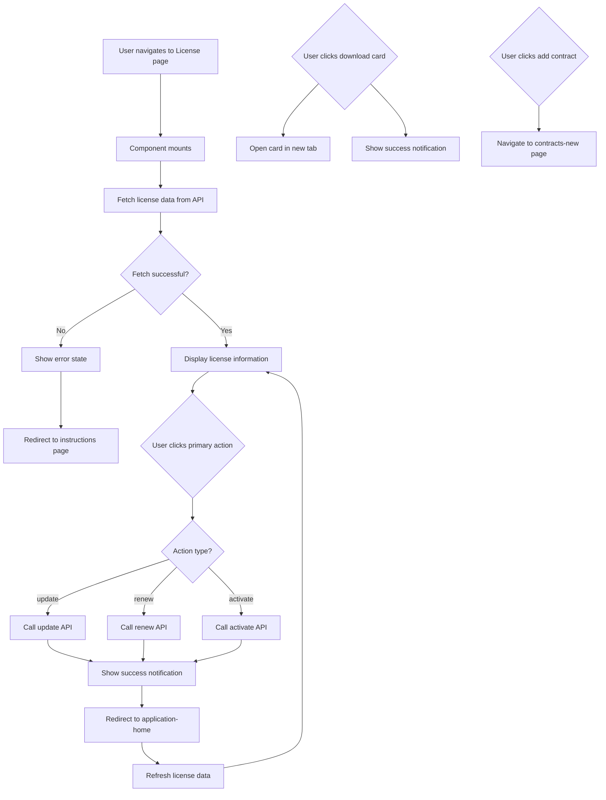

# Professional Diver License - Component Specifications

**Component:** `ProfessionalDiverProfile.vue`  
**Location:** `src/v3/pages/professional-divers/`  
**Version:** 1.1  
**Last Updated:** 2026-02-08  

---

## Overview

The Professional Diver License component displays the user's current professional diver license information, including license status, rank, expiry date, international memberships, and affiliated dive center contracts. It provides actions for license renewal, information updates, and card download.

**Scope Note:** This document covers the authenticated profile/license page (`ProfessionalDiverProfile.vue`) only. Public license validation routes and components were removed from `current_app`; see [Public Page Removal Tracker](../../operations/public-page-removal-tracker.md).

**Related Application Step (v3):**
- License Information (Rank + Card Design) is handled in the application workflow (summary card + edit form).  
  See: [Professional Diver License Information](./professional-diver-license-information.md)

---

## Business Requirements

### Primary Goal
Display comprehensive professional diver license information and provide actions for license management (renew, update, activate) and related operations (download card, manage memberships, manage contracts).

### Key Business Rules

1. **License Status Display**
   - Show current license status (Active, Expired, Terminated)
   - Display license number, rank, and expiry date
   - Show visual indicators for status (color-coded ring around avatar)

2. **License Actions**
   - Primary action depends on license status:
     - **Terminated:** Activate License
     - **Expired:** Renew License (within 90 days of expiry)
     - **Active:** Update Information
   - Download license card if available

3. **International Memberships Display**
   - Display all international memberships for the professional diver
   - Show organization name, title, and status
   - Grid layout adapts to number of memberships (1-2, 3+)
   - At least one international membership record is required for a valid professional diver license
   - Verification happens after application approval; memberships remain Unverified until admin review
   - Unverified memberships are allowed at submission, but each must include evidence (e.g., membership card copy)

4. **Affiliated Dive Centers Display**
   - Display all affiliated dive center contracts
   - Show center name, contract dates, and status
   - Grid layout adapts to number of contracts (1-2, 3+)

5. **Data Loading**
   - Load license data from backend on component mount
   - Handle loading and error states gracefully
   - Refresh data when actions are performed

---

## Functional Requirements

### FR-1: License Information Display
**Priority:** High  
**Description:** Display comprehensive license information with visual status indicators.

**Acceptance Criteria:**
- License number is displayed
- License rank is displayed (if available)
- License status is displayed with appropriate translation
- Expiry date is displayed in readable format
- Avatar/photo is displayed with status ring color
- Status ring color matches license status:
  - Active: Emerald green
  - Expired: Red
  - Terminated: Red
- Initials are displayed if no photo is available

### FR-2: License Actions
**Priority:** High  
**Description:** Provide appropriate actions based on license status.

**Acceptance Criteria:**
- Primary action button is displayed based on status
- **Terminated:** "Activate License" with power-off icon
- **Expired:** "Renew License" with refresh icon (within 90 days)
- **Active:** "Update Information" with pencil icon
- Download card button is displayed if card is available
- Actions trigger appropriate backend API calls
- Success notifications are displayed after actions complete
- User is redirected to appropriate page after action

### FR-3: International Memberships Display
**Priority:** Medium  
**Description:** Display grid of international memberships.

**Acceptance Criteria:**
- Memberships are displayed in a responsive grid
- Grid layout adapts to membership count:
  - 1 membership: Single column, max-width-md
  - 2 memberships: 2 columns (mobile), 3 columns (desktop)
  - 3+ memberships: 3 columns (mobile), 4 columns (desktop)
- Each membership card shows:
  - Organization name
  - Title
  - Status badge
- Empty state is displayed if no memberships exist
- Requirement warning is displayed only when there are zero memberships
- No requirement warning is shown when memberships exist, even if they are Unverified
- Evidence (membership copy) is required for each submitted membership

### FR-4: Affiliated Dive Centers Display
**Priority:** Medium  
**Description:** Display grid of affiliated dive center contracts.

**Acceptance Criteria:**
- Contracts are displayed in a responsive grid
- Grid layout adapts to contract count:
  - 1 contract: Single column, max-width-md
  - 2 contracts: 2 columns (mobile), 3 columns (desktop)
  - 3+ contracts: 3 columns (mobile), 4 columns (desktop)
- Each contract card shows:
  - Center name
  - Contract date range
  - Status badge
  - Auto-renewal badge (if applicable)
- Empty state is displayed if no contracts exist

### FR-5: Data Loading
**Priority:** High  
**Description:** Load license data from backend.

**Acceptance Criteria:**
- License data is fetched from backend on component mount
- Loading state is displayed while fetching
- Error state is displayed if fetch fails
- User is redirected to instructions page if license not found (404) -> **UPDATED (v1.1):** User sees "No License" state with Apply button instead of redirect.

### FR-6: Navigation
**Priority:** High  
**Description:** Navigate to relevant pages after actions.

**Acceptance Criteria:**
- Update action navigates to application-home with application ID
- Renew action navigates to application-home with application ID
- Activate action refreshes data after completion
- Add contract action navigates to professional-diver-contracts-new

---

## Non-Functional Requirements

### NFR-1: Performance
- Page loads in < 2 seconds
- Data refresh completes in < 1 second
- Actions complete in < 3 seconds
- No UI blocking during data loading

### NFR-2: Usability
- Clear visual hierarchy
- Accessible to screen readers
- Keyboard navigation support
- Mobile-friendly layout
- Intuitive action buttons with icons
- Responsive grid layouts

### NFR-3: Security
- All data transmitted over HTTPS
- No sensitive data in client-side logs
- CSRF protection enabled

### NFR-4: Internationalization
- Full Arabic translation support
- RTL layout for Arabic
- English numerals in both languages
- Date format: Display in readable format
- Labels, status, and toast notifications use English keys with Arabic translations in `src/locales/ar.json`

### NFR-5: Browser Compatibility
- Chrome (latest 2 versions)
- Firefox (latest 2 versions)
- Safari (latest 2 versions)
- Edge (latest 2 versions)

---

## Technical Specifications

### Component Architecture

**Pattern:** Single-page display component with data fetching and action handling.

**Key Technologies:**
- Vue 3 Composition API (`<script setup>`)
- PrimeVue components (Button)
- Tailwind CSS with `tw-` prefix
- **Glassmorphism:** Uses `backdrop-blur-md` and semi-transparent backgrounds
- **Animations:** Custom `fade-up` transition for staggered content loading
- Radial gradient background (Mesh Overlay) for premium visual appeal

### Dependencies

**Composables:**
- `useI18n` - Internationalization
- `useRouter` - Navigation
- `useNotification` - User feedback

**API:**
- `apiGet` - GET requests
- `apiPost` - POST requests

### API Endpoints

#### 1. Fetch License Data
**Endpoint:** `GET /professional-divers-applications/pick`  
**Purpose:** Load license, memberships, and contracts data

**Response:**
```json
{
  "license": {
    "id": 123,
    "name_ar": "محمد أحمد علي",
    "name_en": "Mohammed Ahmed Ali",
    "rank": "Diver",
    "status": "Active",
    "expiry_on": "2025-12-31",
    "expires_on": "2025-12-31"
  },
  "usersPicture": {
    "portrait_link": "https://example.com/photo.jpg"
  },
  "licenseCard": {
    "link": "https://example.com/card.pdf",
    "url": "https://example.com/card.pdf"
  },
  "memberships": [
    {
      "id": 1,
      "organization": "PADI",
      "title": "Open Water Diver",
      "status": "Active"
    }
  ],
  "diverContracts": [
    {
      "id": 1,
      "center_name": "Red Sea Diving Center",
      "start_date": "2024-01-01",
      "end_date": "2024-12-31",
      "status": "Active",
      "auto_renewal": true
    }
  ]
}
```

**Error Response (404):**
```json
{
  "message": "License not found"
}
```

#### 2. Update License Application
**Endpoint:** `POST /professional-divers-applications/update-application`  
**Purpose:** Start license update application

**Request:**
```json
{
  "type": "update"
}
```

**Success Response:**
```json
{
  "application": {
    "id": 456
  }
}
```

#### 3. Renew License Application
**Endpoint:** `POST /professional-divers-applications/renew-application`  
**Purpose:** Start license renewal application

**Request:**
```json
{
  "type": "renew"
}
```

**Success Response:**
```json
{
  "application": {
    "id": 789
  }
}
```

#### 4. Activate License
**Endpoint:** `POST /professional-divers-applications/activate`  
**Purpose:** Activate terminated license

**Request:**
```json
{
  "type": "activate"
}
```

**Success Response:**
```json
{
  "message": "License activated successfully"
}
```

#### 5. Request Printed Card
**Endpoint:** `POST /professional-divers-applications/card-request`  
**Purpose:** Request physical license card

**Request:**
```json
{
  "type": "request_printed"
}
```

**Success Response:**
```json
{
  "message": "Card request submitted"
}
```

#### 6. Cancel Request
**Endpoint:** `POST /professional-divers-applications/cancel-request`  
**Purpose:** Cancel card request or renewal

**Request:**
```json
{
  "type": "cancel_request"
}
```

**Success Response:**
```json
{
  "message": "Request canceled"
}
```

### State Management

**Loading States:**
- `loading` - Data fetching state

**Data State:**
- `license` - License data
- `usersPicture` - User photo data
- `licenseCard` - Card link data
- `memberships` - International memberships array
- `contracts` - Dive center contracts array

**Computed Properties:**
- `photoUrl` - Full URL for user photo
- `displayName` - User name based on locale
- `initials` - User initials (fallback if no photo)
- `expiry` - Expiry date (normalized field)
- `expiryDate` - Formatted expiry date
- `statusKind` - Normalized status (terminated/expired/valid)
- `statusBarClass` - Status bar color class
- `avatarRingClass` - Avatar ring color class
- `isWithinRenewWindow` - Whether within 90-day renewal window
- `primaryAction` - Primary action object (key, label, icon)
- `hasCard` - Whether card download is available
- `cardLink` - Full URL for card download

---

## User Flow



---

## Edge Cases

### EC-1: License Not Found
**Scenario:** User navigates to license page but no license exists (404 response)
**Expected:** Silent 404 handling (no global error toast)
**Action:** Display "No Professional License Found" empty state with "Apply for New License" button. Do NOT redirect automatically.

### EC-2: Expired License Outside Renewal Window
**Scenario:** License is expired but more than 90 days past expiry  
**Expected:** Primary action is "Update Information"  
**Action:** User can view license but cannot renew directly

### EC-3: No Card Available
**Scenario:** User clicks download card but no card link exists  
**Expected:** Error notification  
**Action:** Show "No card available" message, prevent download

### EC-4: No Memberships
**Scenario:** User has no international memberships  
**Expected:** Empty state displayed with requirement warning  
**Action:** Show requirement message indicating at least one membership is required

### EC-5: Unverified Memberships
**Scenario:** User has memberships with status Unverified  
**Expected:** Memberships display with Unverified status, no requirement warning  
**Action:** No requirement message shown while memberships are pending verification; evidence is required for submission

### EC-5: No Contracts
**Scenario:** User has no affiliated dive center contracts  
**Expected:** Empty state displayed  
**Action:** Show appropriate empty state message or hide section

### EC-6: Action Failure
**Scenario:** API call fails (update, renew, activate, etc.)  
**Expected:** Error notification  
**Action:** Display error message, keep user on page

### EC-7: Photo URL Missing
**Scenario:** User has no profile photo  
**Expected:** Initials displayed instead of photo  
**Action:** Show initials in avatar placeholder

---

## Testing Requirements

### Unit Tests
- [ ] Computed properties calculate correctly
- [ ] Status kind normalization works (terminated/expired/valid)
- [ ] Renewal window calculation is accurate (90 days)
- [ ] Primary action logic is correct for all statuses
- [ ] Card link handling works with relative and absolute URLs

### Integration Tests
- [ ] License data loads from API
- [ ] Loading state displays correctly
- [ ] Error state displays on 404
- [ ] Update action creates application and navigates
- [ ] Renew action creates application and navigates
- [ ] Activate action completes and refreshes data
- [ ] Card download opens in new tab
- [ ] Memberships display correctly
- [ ] Requirement warning displays only when there are zero memberships
- [ ] No requirement warning when memberships exist but are Unverified
- [ ] Contracts display correctly

### E2E Tests
- [ ] Complete user flow from page load to actions
- [ ] Status indicators are visually correct
- [ ] Responsive layouts work on mobile/tablet/desktop
- [ ] Error handling works correctly
- [ ] Success notifications display

---

## Accessibility Requirements

- [ ] All form fields have proper labels
- [ ] Status indicators have appropriate ARIA labels
- [ ] Buttons have accessible labels
- [ ] Grid layouts are keyboard navigable
- [ ] Screen reader announces status changes
- [ ] Focus management on error display
- [ ] Color contrast meets WCAG AA standards

---

## Translation Requirements

### English (Default)
English strings are used directly as i18n keys (no extra mapping layer).

### Arabic
All user-facing text must be translated in `src/locales/ar.json`, including:
- Status labels (Active, Expired, Terminated)
- Action labels (Renew License, Update Information, Activate License, Download License Card)
- Section headers (International memberships, Affiliated dive centers)
- Toast messages
- Empty state messages
- Error messages

Minimum required keys for this page:

```json
{
  "License number": "رقم الترخيص",
  "Rank": "الرتبة",
  "Status": "الحالة",
  "Expiry on": "تنتهي في",
  "Renew License": "تجديد الترخيص",
  "Update Information": "تحديث المعلومات",
  "Activate License": "تفعيل الترخيص",
  "Download License Card": "تحميل بطاقة الترخيص",
  "International memberships": "العضويات الدولية",
  "Affiliated dive centers": "مراكز الغوص التابعة",
  "Dates": "التواريخ",
  "Auto renewal": "تجديد تلقائي",
  "No card available": "لا توجد بطاقة متاحة",
  "Card download started": "بدء تحميل البطاقة",
  "Update application started": "بدء تحديث الطلب",
  "Renewal started": "بدء تجديد الترخيص",
  "Activation request submitted": "تم إرسال طلب التفعيل",
  "Printed card requested": "تم إرسال طلب طباعة البطاقة",
  "Request canceled": "تم إلغاء الطلب",
  "Something went wrong": "حدث خطأ ما"
}
```

---

## Future Enhancements

1. **License History**
   - Show previous license versions
   - Display renewal history
   - Track status changes over time

2. **Digital License Card**
   - Display digital license card in-app
   - Generate QR code for verification
   - Enable wallet integration

3. **Membership Management**
   - Add new membership from this page
   - Update membership details
   - Cancel membership

4. **Contract Management**
   - Add new contract from this page
   - Update contract details
   - Cancel contract

5. **Performance Metrics**
   - Show diving statistics
   - Display activity timeline
   - Track renewal patterns

---

## References

- [NewLicense.vue](../../../src/v3/pages/applications/professional-divers/NewLicense.vue) - New license application component
- [Public Page Removal Tracker](../../operations/public-page-removal-tracker.md) - confirms public professional-diver license validation moved out of `current_app`
- [Professional Diver Design System](../design/professional-diver-design-system.md) - Shared visual system for profile and validation pages
- [Global Development Guide](../guides/global-guide.md) - Coding standards and patterns
- [Translation Guide](../guides/translation-guide.md) - i18n best practices

---

**Last Updated:** February 8, 2026  
**Version:** 1.1  
**Status:** Active
